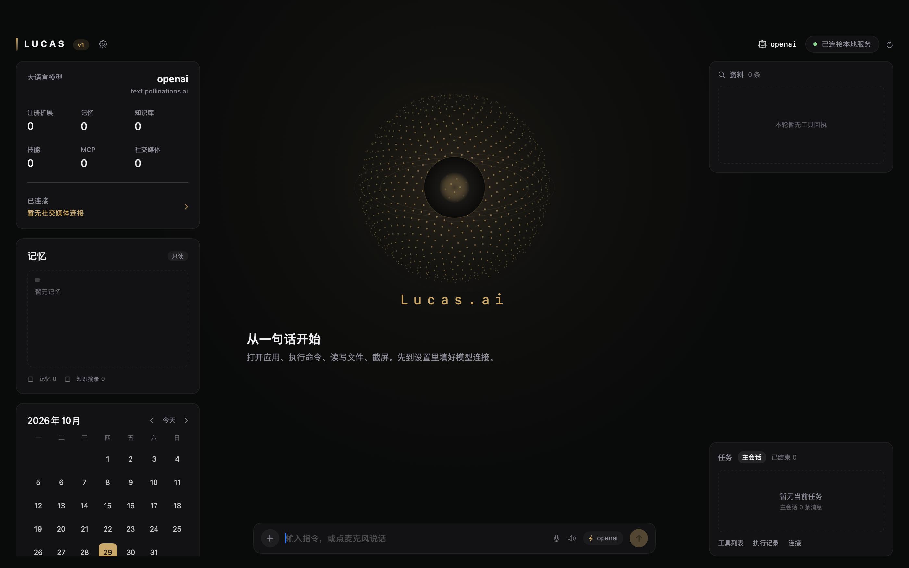
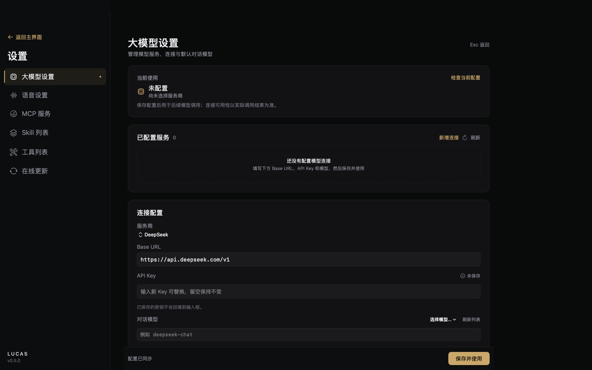
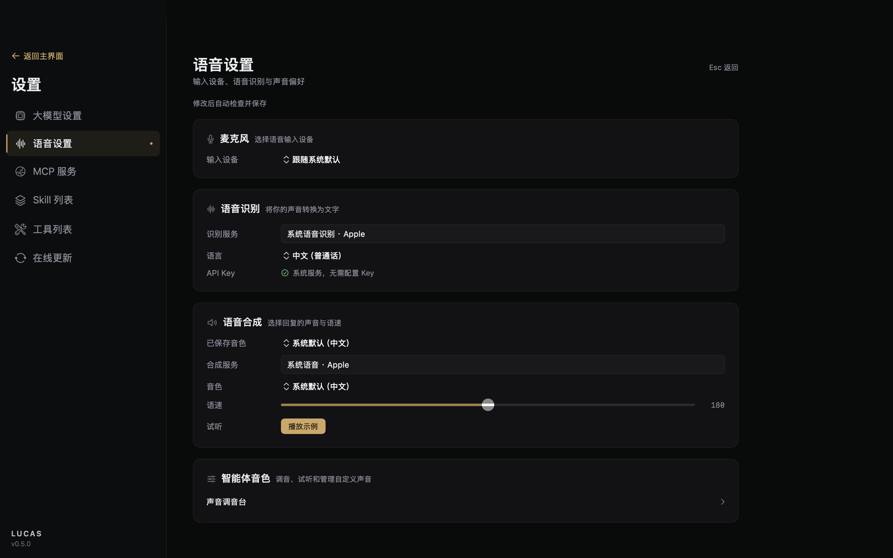
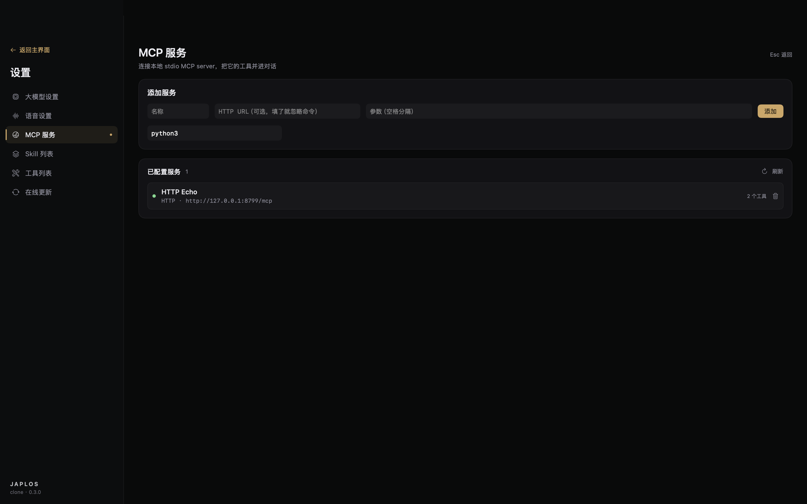
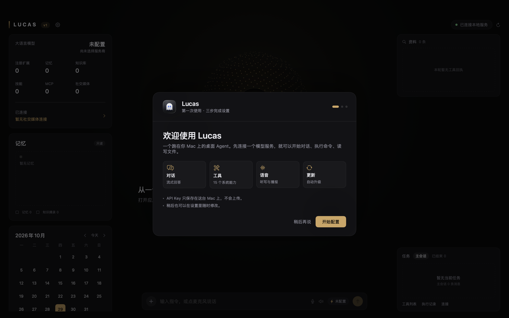
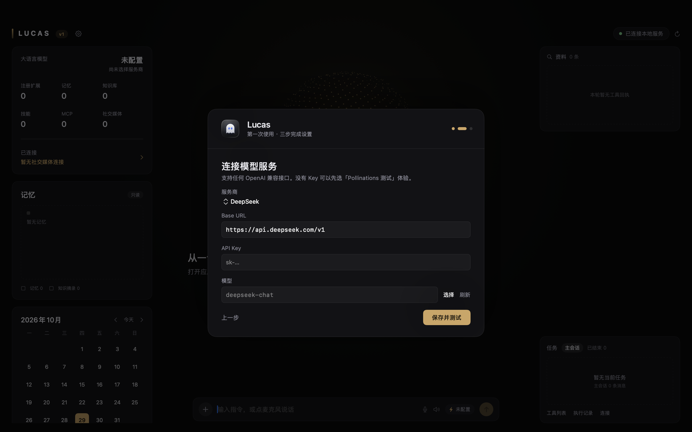
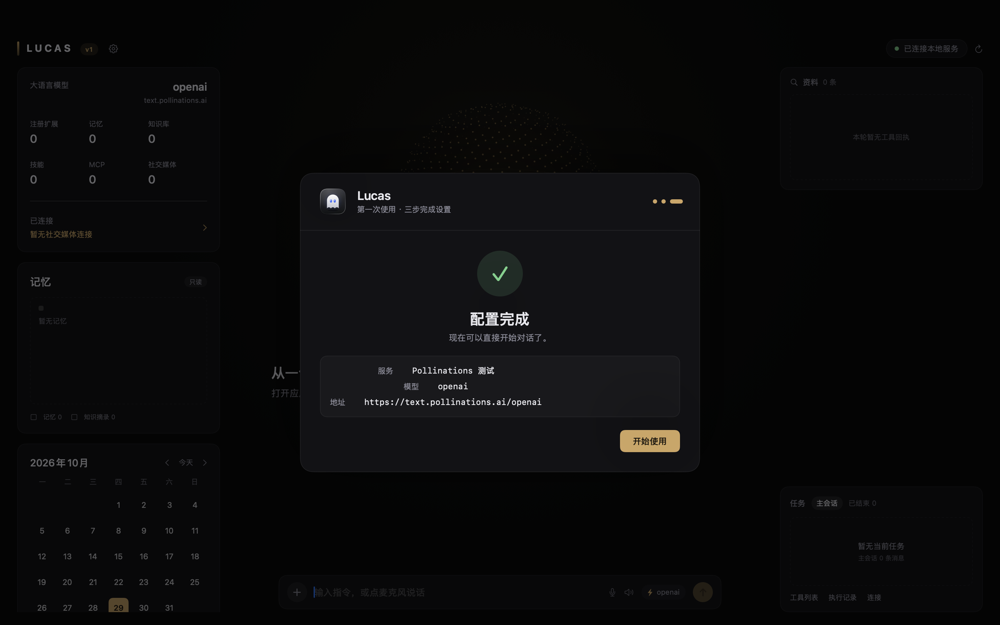

# Lucas Agent — Japlos v2 的功能等价复刻

用 Swift 原生实现的桌面 Agent，架构对齐原版 Japlos v2：**SwiftUI 客户端 + 常驻内核进程 + Unix Socket 能力授权 + SQLite 持久化 + 分层提示词 + ReAct 工具循环**。

> 这是独立实现，不复用原版二进制、资源或提示词文本；行为与协议按 [REPORT.md](../REPORT.md) 中的逆向结论重新实现。


## 项目文档

完整的架构、协议、数据模型、发布流程与服务器配置见 **[docs/PROJECT.md](docs/PROJECT.md)**；在线更新的部署细节见 [docs/updates.md](docs/updates.md)。

## 当前进度（MVP，可运行）

| 能力 | 状态 | 说明 |
|---|---|---|
| 双进程架构 | ✅ | `Lucas.app` ⇄ `lucasd`（Unix Socket，0600） |
| 帧协议 | ✅ | 4 字节大端长度 + JSON，上限 16 MiB，与原版一致 |
| 能力授权 | ✅ | 31 个能力命名、`local-user` 引导授权、拒绝格式与原版一致 |
| SQLite 持久化 | ✅ | sessions / turns / configurations / permission_grants / tool_invocations |
| 分层提示词 | ✅ | identity / behavior / execution / tool-policy / 场景注入，可在 `Prompts/` 覆盖 |
| 场景路由 | ✅ | 音乐、应用、截屏、文件、命令、时间、剪贴板（正则匹配） |
| ReAct 循环 | ✅ | 模型 → 工具 → 回执 → 模型，最多 8 轮，预算耗尽有兜底 |
| 工具 | ✅ 15 个 | 时间、Shell、应用、文件、截屏、剪贴板、音乐、音量、打开链接、窗口列表、进程列表、网络信息、PDF 生成、文件下载、系统通知 |
| 首次引导 | ✅ | 三步向导：欢迎 → 连接模型（含 Pollinations 免 Key 测试）→ 完成 |
| 聊天 UI | ✅ | 会话侧栏、气泡、工具回执 chip、设置面板 |
| 流式输出 | ✅ | `/chat/completions` SSE → 多帧 Socket 流（`delta` / `tool` / `done`），界面逐字渲染 |
| 停止生成 | ✅ | 取消消费任务 → 关闭 socket → 内核 Task 取消，模型与工具不再继续 |
| 工具审批 | ✅ | 高风险工具执行前发 `approval` 帧，界面弹窗允许/拒绝，拒绝则不执行 |
| 语音输入 | ✅ | 系统 Speech 流式识别，点麦克风开始/停止，转写实时显示并在停止后发送 |
| 语音播报 | ✅ | 系统 TTS 朗读最终回答；可选音色/语速，自动跳过代码块，输入条可一键开关 |
| MCP 客户端 | ✅ | stdio（newline JSON-RPC）与 HTTP（JSON / SSE，支持 `Mcp-Session-Id`）；设置页增删服务，工具自动并入对话 |
| 模型目录 | ✅ | 读取 `/v1/models`，设置页一键刷新 + 选择模型，失败可继续手填 |
| 真实对话 | ✅ | 已用真实 provider（Pollinations `gpt-oss-20b`）验证对话 + 工具调用，见 [docs/real-conversation.md](docs/real-conversation.md) |
| 上下文预算 | ✅ | 历史按 48k 字符预算从最近回合截断，保持 tool call / result 成对 |
| 消息操作 | ✅ | 悬停助手消息可一键复制 |
| Markdown | ✅ | 代码块（含复制）、标题、列表、行内样式 |
| Shell 安全护栏 | ✅ | 常开黑名单：`sudo`、`mkfs`、`diskutil erase`、`dd of=/dev/*`、关机、fork bomb、`rm -rf /` 等 |
| 设置 | ✅ | Base URL / 模型 / API Key / 温度，保存到内核并支持连接测试 |
| 单元 + 端到端测试 | ✅ | `swift test` + `scripts/smoke_test.sh`（mock 模型跑通完整链路） |

**尚未实现**：微信/飞书通道、工具自举、自愈/更新。见文末路线图。

## 界面

主界面按原版的三栏工作台布局：左侧模型 / 记忆 / 日历，中间**旋转粒子球**与对话，右侧资料与任务面板。

- 顶栏 LUCAS 前有琥珀色竖条，右侧是本地服务连接状态
- 大语言模型卡：标题左、模型/服务商右对齐，两行三列统计，分隔线下方橙色「暂无社交媒体连接」
- 呼吸球是 1100 个斐波那契球面粒子投影 + 缓慢自转 + 呼吸脉动，不是平面圆环
- 记忆卡、日历、任务面板均按截图比例调整
- 设置页共用一套 `SettingsMetrics` 设计变量（字号/间距/宽度），四个页面尺寸一致



设置是独立的全屏视图（左侧页面导航、右侧内容），不是弹窗：



语音设置（输入 + 播报）：



MCP 服务：



> 窗口由 AppKit 直接管理，不是 SwiftUI `WindowGroup`：关闭窗口不会退出进程，点击 Dock 图标或按 ⌘0 可重新打开。

窗口缩放时：左栏固定 292pt 宽、内容独立滚动；右栏固定 300pt；中间栏自适应，呼吸球在 200–380pt 高度区间缩放，输入条始终贴底。最小窗口 1120×720。


## 首次启动引导

第一次打开（或尚未配置模型）会显示三步向导，不需要先找到设置页：

1. **欢迎**：介绍对话、工具、语音、自动更新
2. **连接模型**：服务商预设（DeepSeek / MiMo / Pollinations 测试 / 自定义）、Base URL、API Key、模型；可刷新模型列表、测试连接
3. **完成**：展示服务/模型/地址，点「开始使用」进入主界面







- 连接成功后写入 `agents.default.model.connection`，并记下 `LucasOnboardingCompleted`
- 点「稍后再说」只隐藏本次，下次启动还会提示
- 已配置或已完成引导的用户不会看到

## 快速开始

```bash
cd clone

# 1. 构建 .app
./scripts/build-app.sh release

# 2. 启动（首次会进入设置填模型）
open build/Lucas.app

# 3. 设置里二选一：
#    a) 服务商选「Pollinations 测试」→ 保存并使用（免 Key，有频率限制）
#    b) 填自己的 DeepSeek / MiMo / 任意 OpenAI 兼容连接
```

也可以用开发模式运行：

```bash
swift run --disable-sandbox lucasd    # 终端 A
swift run --disable-sandbox JaplosApp  # 终端 B
```

开发时建议把状态放进仓库，避免污染 `~/Library`：

```bash
export LUCAS_CLONE_HOME="$PWD/run"
```

## 架构

```
Lucas.app (SwiftUI)
  AppModel ── KernelClient ──┐
                             │  Unix Socket: ~/Library/Application Support/Lucas/kernel.sock (0600)
                             ▼
                        lucasd (KernelCore)
                          ├─ PolicyEngine     能力授权
                          ├─ KernelStore      SQLite
                          ├─ ToolRegistry     6 个原生工具
                          └─ ChatService      提示词 → 模型 → 工具循环
                                  │
                                  ▼
                        OpenAI 兼容 /chat/completions
```

协议示例：

```json
// 请求
{"protocolVersion":"1.0","id":"UUID","principal":"local-user",
 "operation":"chat.send","arguments":{"text":"现在几点？"}}

// 响应
{"protocolVersion":"1.0","requestID":"UUID",
 "result":{"sessionID":"…","text":"现在是 15:22…","steps":[{"tool":"system.time","ok":true}]},
 "servedAt":"2026-10-29T07:22:34Z"}
```

不带 App 也能调内核：

```bash
export LUCAS_SOCKET="$PWD/run/kernel.sock"
python3 scripts/kernel_rpc.py kernel.status '{}'
python3 scripts/kernel_rpc.py tool.invoke '{"name":"system.time","arguments":{}}'
```

## 目录

```
clone/
├── Package.swift
├── Sources/
│   ├── JaplosProtocol/    帧编解码、请求/响应、能力、授权、工具与对话模型
│   ├── JaplosKernel/      SQLite、策略引擎、工具注册表、内置工具、Unix Socket 服务
│   ├── JaplosRuntime/     提示词库、场景路由、模型客户端（阻塞 + SSE）、ReAct 循环
│   ├── lucasd/           内核守护进程入口
│   └── JaplosApp/         SwiftUI 客户端
├── Tests/                 协议与策略单测
├── scripts/
│   ├── build-app.sh       构建 .app 包
│   ├── smoke_test.sh      端到端冒烟测试（含 mock 模型）
│   ├── kernel_rpc.py      Python 版内核客户端
│   └── mock_model.py      脚本化 OpenAI 兼容服务
└── build/Lucas.app  产物
```

## 测试

```bash
swift test --disable-sandbox      # 7 个协议/策略单测
./scripts/smoke_test.sh           # 内核 + 工具 + ReAct 全链路
```

`smoke_test.sh` 会临时起内核与 mock 模型，验证 16 项：状态查询、工具调用、越权拒绝、配置写入、阻塞式 `chat.send`、流式多帧协议（delta/tool/done）、历史落库、断流取消、危险命令拦截、高风险工具审批（允许/拒绝）。

## 安全说明

- Socket 权限 `0600`，服务端校验对端 UID；但**同一用户下的任意进程都能以 `local-user` 接入**——与原版相同的信任边界。
- `system.command.shell.execute` 是高风险工具，当前没有审批弹窗，模型被提示要求先确认，但这只是提示词约束。不要在不可信会话里放权。
- API Key 存在 `~/Library/Application Support/Lucas/kernel.sqlite3`（0600），未使用 Keychain——与原版选择一致，介意的话可以改。
- 截屏/自动化会触发 TCC 授权，首次调用需要你在系统设置里放行。

## 路线图

1. **M3**：把工具补齐到 20+（下载、PDF、窗口管理、蓝牙、剪贴板历史）
2. **M4**：流式 TTS（当前是系统整段播报）与播放队列、打断
3. **M5**：MCP OAuth 授权流程与微信/飞书通道
4. **M5**：MCP 客户端（stdio/HTTP/OAuth）与微信/飞书通道
5. **M6**：工具自举流水线、自愈、Sparkle 更新

对照原版逐项验收的标准见 [../REPORT.md](../REPORT.md) 第 8、10、11、14 节。
